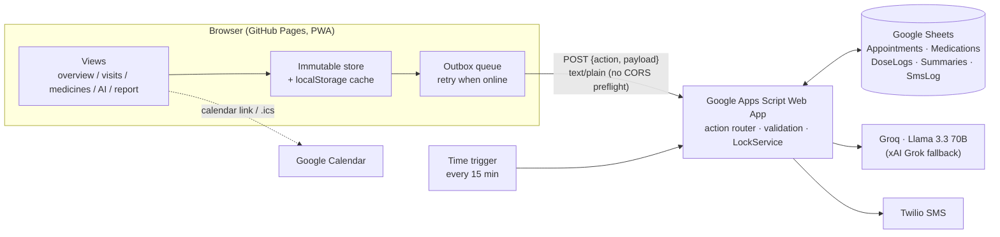

# RK Health — AI Smart Patient Appointment & Medication Reminder System

A web app that keeps a patient's **appointments, medicine schedule, AI visit summaries and a printable health report** in one calm dashboard. Built with zero frontend dependencies on top of a serverless Google stack.

**Live demo:** https://nkhan005.github.io/RK_Health_App/ (demo PIN `1234`, then *Load sample week*)

---

## Features

| Area | What it does |
|---|---|
| **Overview dashboard** | Greeting, today's dose checklist, next-visit countdown, 7-day adherence ring + bar chart (hover/focus tooltips), visit attendance %, latest AI summary |
| **Appointments** | Agenda grouped by day, search + status filters (Upcoming / Today / Missed / Attended), automatic missed-visit detection, *Mark attended*, one-click **Google Calendar** link and **.ics** download (1-hour reminder), *Summarize visit* shortcut |
| **Medicines** | Multiple dose times per medicine (presets + custom), tap to mark doses taken, 7-day history strip per medicine, pause/resume, **Twilio SMS** "send reminder now" + automatic scheduled reminders |
| **AI visit summaries** | Doctor's notes → structured plain-language summary (Overview, Diagnosis, Medicines, Follow-up) via **Groq Llama 3.3 70B** (optional xAI Grok fallback). If the AI is unreachable, an on-device draft is created and clearly labelled |
| **Health report** | Generated from data (not scraped from the page): stats, medicine adherence table, appointments, summaries. Filter by patient, **Print / Save as PDF**, **CSV export** |
| **Security** | PIN keypad lock with salted SHA-256 hash, 5-attempt lockout, auto-lock after 5 min idle, XSS-safe rendering, Content-Security-Policy, all API keys server-side only |
| **Works offline** | Offline-first store + outbox queue: changes save instantly and sync to Google Sheets when online. Installable PWA |
| **UX** | Light/dark theme, mobile bottom tab bar, native `<dialog>` sheets, inline validation, toasts with **Undo**, keyboard and screen-reader friendly |

## Architecture



## Tech stack

- **Frontend:** HTML5, modern CSS (design tokens, grid, `color-mix`, native `<dialog>`), vanilla **ES modules**. No framework, no build step, ~31 KB of JS gzipped
- **Backend:** Google Apps Script (V8) Web App
- **Database:** Google Sheets (plain-text cells, header-mapped rows, UUID ids)
- **Integrations:** Groq API (Llama 3.3 70B), Twilio Programmable SMS, Google Calendar
- **Hosting:** GitHub Pages + service worker (offline cache)
- **Tests:** Node's built-in test runner (`npm test`), zero dependencies

## Project structure

```
index.html            App shell, dialogs, lock screen
css/                  tokens · base (shell) · components · views · print
js/
  app.js              Boot, router, render loop, event delegation
  actions.js          Create / update / delete for every feature
  domain.js           Pure logic: validation, adherence, statuses, calendar export (unit-tested)
  store.js            Immutable state + persistence
  sync.js             Outbox flush + GET_ALL merge
  api.js              Apps Script client with timeout + error classes
  auth.js             PIN hashing, lockout, idle lock
  ui.js               Safe html`` templating, toasts, dialogs, icons
  ai-fallback.js      On-device summary draft when AI is offline
  seed.js             Sample week for demos (never synced)
  views/*.js          One module per screen
backend/
  Code.gs             Apps Script backend
  appsscript.json     Manifest (timezone, scopes, web app access)
tests/                Unit tests
sw.js, manifest.webmanifest, icon.svg   PWA
```

## Running locally

```bash
npm test          # 15 unit tests
npm start         # serves http://localhost:5173 (any static server works)
```

## Deploying the backend (Google Apps Script)

1. Open your Google Sheet → **Extensions → Apps Script**.
2. Replace `Code.gs` with [`backend/Code.gs`](backend/Code.gs). In *Project Settings* tick "Show appsscript.json manifest file" and paste [`backend/appsscript.json`](backend/appsscript.json).
3. **Project Settings → Script properties**, add `GROQ_API_KEY`, `TWILIO_ACCOUNT_SID`, `TWILIO_AUTH_TOKEN`, `TWILIO_FROM` (optional: `XAI_API_KEY`, `SHEET_ID`).
4. Run `setup()` once from the editor. It creates the tabs and the 15-minute reminder trigger, and asks for permissions.
5. **Deploy → Manage deployments → Edit (pencil) → Version: New version → Deploy.** This keeps the same `/exec` URL, so the frontend needs no change. (With a brand-new deployment instead, paste its URL in **Settings → Cloud backend**.)

### API actions

`PING`, `GET_ALL`, `ADD_APPOINTMENT`, `UPDATE_APPOINTMENT`, `DELETE_APPOINTMENT`, `ADD_MEDICATION`, `UPDATE_MEDICATION`, `DELETE_MEDICATION`, `LOG_DOSE`, `DELETE_DOSE`, `SEND_SMS`, `GENERATE_SUMMARY`, `DELETE_SUMMARY`.
Every response is `{ "status": "success" | "error", ... }`.

## Notes and limits

- The PIN is a **device privacy lock**, not multi-user authentication. Anyone with the Web App URL can call the API, so do not store real patient data in a public demo. Production would add Google Sign-In and per-user sheets.
- AI summaries help patients understand a visit; they are **not medical advice**.
